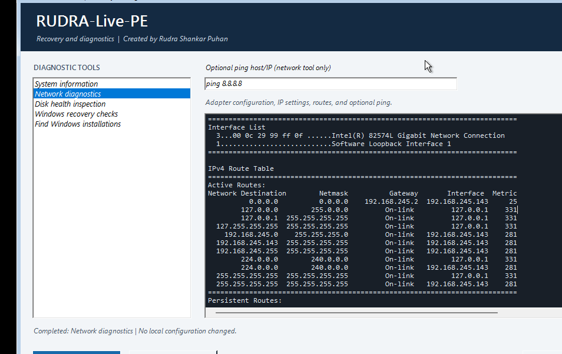

# RUDRA-Live-PE

**Windows PE Recovery and Diagnostics Toolkit**  
Created by **Rudra Shankar Puhan**

RUDRA-Live-PE is a technician-oriented launcher for Microsoft Windows Preinstallation Environment (WinPE). It uses built-in Windows and ADK components to provide system information, network diagnostics, disk inspection, recovery checks, and log collection.

<p align="center">
  
</p>

<p align="center">
  <a href="docs/video/RUDRA_LIVE_PE.mp4">▶ Watch RUDRA-Live-PE Demo</a>
</p>

> **Project status:** The ISO has been validated and boot-tested in VMware Workstation. Network diagnostics and ping functionality were tested. Third-party recovery media is embedded and chain-booted.

## Project Contents

- **Build-RUDRA.ps1** locates the installed Windows ADK and builds from the project-local staging tree.
- **Start-RUDRA.ps1** is the WinPE graphical launcher.
- **RUDRA-Tools.psm1** provides read-only diagnostics and explicit log export.
- **Validate-RUDRA.ps1** checks the ISO boot catalog, media files, WIM contents, and startup launcher.
- **Test-RUDRA.ps1** performs portable project-file and PowerShell syntax checks.
- **RUDRA-Live-PE-Build\media** contains the project-local copy of the staged boot media and `boot.wim`.
- **RUDRA-Live-PE-Build\bootbins** contains the BIOS/UEFI boot files required by MakeWinPEMedia.
- **outputs** receives the ISO and build manifest after a successful build.
- **RUDRA-Live-PE-Build\logs** receives build and validation transcripts.

The project-local `boot.wim` was verified against the original staged WIM by SHA-256 before implementation. All build operations use the project-local copy. The original `C:\RUDRA-Live-PE-Build` tree is protected by the build script and is never used as a write target.

## Included Tools

- **System information:** Computer manufacturer/model, processor, memory, and BIOS version.
- **Network diagnostics:** Adapter, IP, DNS, gateway, and route information. An optional ping target is validated before use.
- **Disk health inspection:** Read-only disk inventory and provider-reported health status when WinPE drivers expose it.
- **Windows recovery checks:** Searches mounted drive-letter volumes for offline Windows registry hives and standard BCD files.
- **Log collection:** Copies the RUDRA session log and available DISM, CBS, SetupAPI, and Windows Setup logs into a new folder selected by the operator.
- **Password and account recovery guidance:** Provides supported account-recovery paths and clearly identifies what RUDRA does not reset itself.
- **Lazesoft recovery media workflow:** Documents how to boot the separate ISO. In the current VMware test, the wizard opened but did not detect a Windows installation.
- **Disk and data recovery triage:** Read-only-first guidance to avoid writing to a source disk.
- **Technician toolkit:** Offers explicit launch of built-in PowerShell or File Explorer.

Diagnostics do not repair, format, repartition, delete, or overwrite disks. Log collection copies only the listed diagnostic logs and asks for confirmation. A log package can contain device names, file paths, and timestamps. Session logs are stored on the WinPE RAM drive and are lost at shutdown unless exported.

## Prerequisites

- A supported Windows ADK with **Deployment Tools**.
- The matching **Windows PE add-on** for the ADK.
- The amd64 optional components and `en-us` resources for:
  - WinPE-WMI
  - WinPE-Scripting
  - WinPE-NetFx
  - WinPE-PowerShell
  - WinPE-StorageWMI
- The supplied project-local RUDRA-Live-PE-Build media and boot files.
- Administrator privileges to service a WIM and generate an ISO.

The builder checks the registry and standard Windows Kits installation folders for ADK tools. It reports missing ADK files or WinPE optional components before attempting WIM servicing.

## Build

Open **Deployment and Imaging Tools Environment** with **Run as administrator**, then run PowerShell from that window:

```powershell
Set-Location 'C:\Users\krish\Documents\Codex\2026-10-19\hel-2'
.\Build-RUDRA.ps1
```

The default workspace is `.\RUDRA-Live-PE-Build`. The build copies its media and boot files into `RUDRA-Live-PE-Build\work\RUDRA-Live-PE`, verifies the base-image hash, services only that working copy, creates an ISO, and validates the ISO before promoting it to `outputs\RUDRA-Live-PE.iso`. A JSON manifest is written beside the ISO.

If servicing and ISO creation completed but validation was interrupted, validate and publish the existing temporary ISO without servicing the WIM again. Run this from the same elevated environment, replacing the example filename with the ISO in `RUDRA-Live-PE-Build\work`:

```powershell
.\Build-RUDRA.ps1 -ValidateOnly -IsoPath '.\RUDRA-Live-PE-Build\work\RUDRA-Live-PE-YYYYMMDD-HHMMSS.iso'
```

Validation-only mounts the ISO and its WIM read-only. It publishes the ISO only after validation succeeds and both documented output paths are still free. If validation fails or either output already exists, the temporary ISO is preserved. This mode never resets the working tree or overwrites outputs.

Existing working trees and outputs are protected. To discard and recreate the project-local working tree, inspect it first and explicitly pass `-ResetWorkingImage`. To replace an existing ISO and manifest after a successful rebuild, explicitly pass `-ForceISO`. For both:

```powershell
.\Build-RUDRA.ps1 -ResetWorkingImage -ForceISO
```

The script never writes to USB and never changes host boot configuration. RemoteSigned is scoped to the WinPE PowerShell process used to start the local launcher; a Group Policy execution policy takes precedence.

## Validation and Testing

Run static checks without elevation:

```powershell
.\Test-RUDRA.ps1
```

This checks required project files, PowerShell parser errors, path safety, the `Require` Boolean regression, validation-only resume safeguards, collision-safe transcript naming, and host-side smoke checks for the diagnostic reports. It does not service WIM files or execute the WinPE diagnostics inside WinPE.

The elevated build validator checks the ISO 9660/El Torito boot catalog, BIOS and UEFI boot files, the ISO boot.wim hash, WIM index, launcher files, and startup command. These checks establish structural validity, not compatibility with every physical machine.

**VMware testing:** The ISO was booted in VMware Workstation. The launcher and network diagnostics were tested, including ping output. Hardware compatibility may differ depending on firmware settings and available drivers.

See `TESTING.md` for the current completed, failed, blocked, and not-yet-tested checklist.

## Privileges and Limitations

Project editing, the harmless workspace write check, and static script checks can run without administrator privileges. WIM servicing and ISO generation require an elevated environment.

Disk and network visibility depends on available WinPE drivers. Disk-health values are passed through from the Windows storage provider and are not a vendor SMART self-test or guarantee. Recovery checks detect file presence on mounted volumes only; they do not unlock encrypted volumes, validate boot configuration contents, or repair Windows.

No host boot configuration, firmware, Secure Boot, BitLocker, recovery partition, or USB device is modified. Do not add third-party binaries unless their licensing permits redistribution. Microsoft ADK/WinPE files remain subject to Microsoft's license terms for the installed release; review those terms before sharing an ISO.

## Troubleshooting

- **ADK tools not found:** Install Windows ADK Deployment Tools and the matching Windows PE add-on.
- **Missing CAB/resource file:** Confirm the amd64 WinPE optional components and `en-us` language resources are installed.
- **Error 740 or access denied:** Start Deployment and Imaging Tools Environment with **Run as administrator**.
- **Script startup is blocked:** Follow the machine's execution policy. Group Policy settings are not overridden by this project.
- **ISO validation fails:** Inspect the build and validation transcripts under `RUDRA-Live-PE-Build\logs`; preserve the working tree and logs before deciding whether to reset.
- **Network/storage device is missing in WinPE:** The base image may need a compatible driver. Check driver compatibility and distribution terms before adding it.

